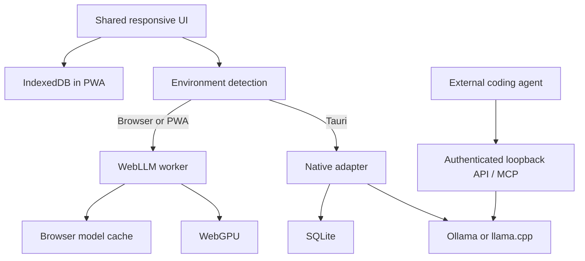

# Architecture

A single React/TypeScript UI runs in two deliberately separate environments. Browser/PWA mode can never enable native engine access. Native IPC is available only inside Tauri.

## Core abstraction

`engineController` owns `currentEngine: 'webllm' | 'native'`, `selectedModel`, the native backend choice, readiness, download progress and generation state. `useEngine()` subscribes without duplicating that state. `getAICompletion(prompt)` is a simple wrapper around the same controller. The full `complete(messages, options)` wrapper accepts streaming callbacks and cancellation.

A model is never marked loaded merely because it appears in the catalog. Browser loading checks WebGPU support and invokes WebLLM's real reload callback. Desktop readiness confirms that the selected installed model is available through the chosen local service; that service loads it on the first completion.

## Local data

Desktop conversations and settings go through parameterized SQLite commands in Rust. The PWA uses IndexedDB for the same shapes. Model files are owned by Ollama or WebLLM's cache, respectively; do not delete those caches while merely updating the frontend shell.

## Agent boundary

The desktop HTTP bridge binds 127.0.0.1:11435 and starts disabled. Bearer authorization and loopback Host checks guard every request; requests carrying a browser Origin are rejected. The OpenAI route preserves tool-call payloads for external agents. The exported MCP server only exposes model/system functions, not an editor or arbitrary filesystem commands.

The imported MCP client is a separate feature. An imported profile stays disabled until reviewed, never starts automatically, removes sensitive configuration where recognized, and requires confirmation before executing a tool. Stdio is launched without shell interpolation. A trusted MCP server can itself have powerful capabilities; those belong to the server and its user permissions.

## Release trust

GitHub Actions builds Windows artifacts without a private updater key. A separate job requests a short-lived OIDC identity, exchanges it with the exact-repository signing broker, signs the finished executable, and publishes immutable GitHub release artifacts plus latest.json. The desktop updater verifies the signature against its embedded public key. Authentication of the updater is separate from Windows Authenticode publisher signing.

## Verification limits

Automated tests can validate state transitions, validation, storage, proxying and packaging. They cannot establish that every GPU, Windows driver or mobile browser can run a selected model. Record actual device tests separately in CHECKLIST.md and the release notes.
